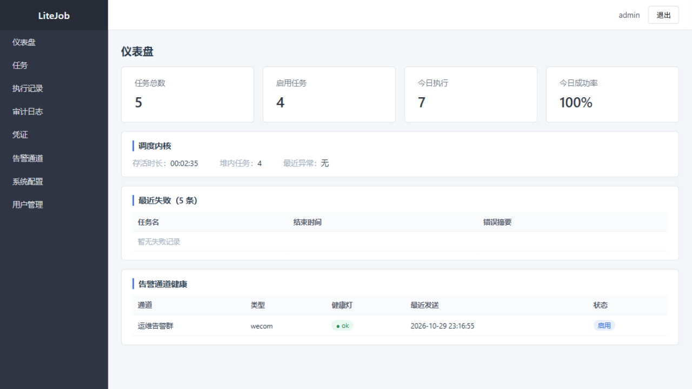
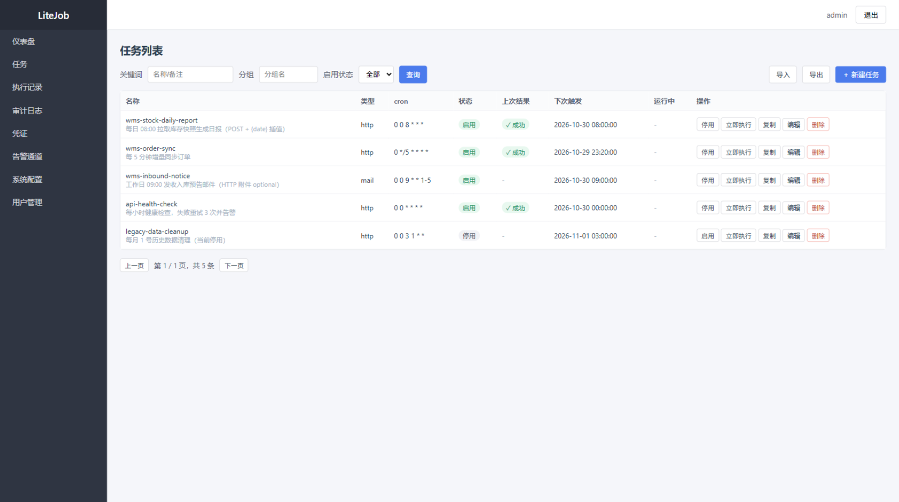
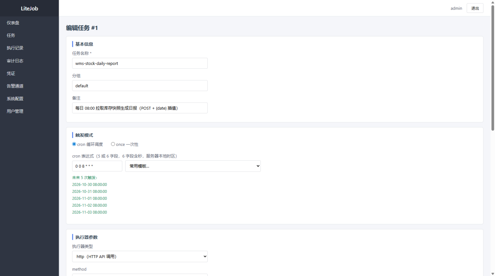
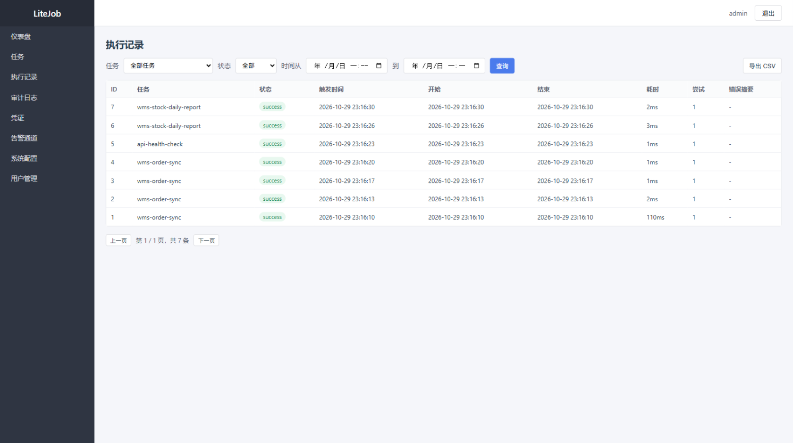
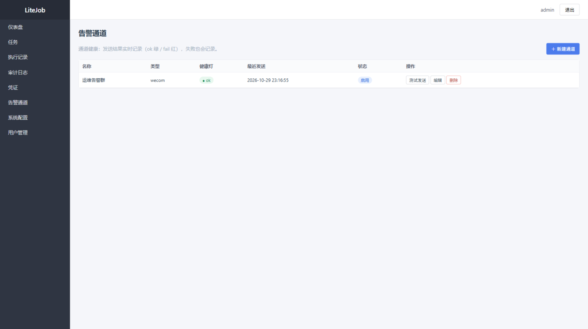

# LiteJob · 单机轻量定时任务调度中心

[](https://dotnet.microsoft.com/)
[](#测试)
[](https://www.sqlite.org/)
[](./LICENSE)

一个 .NET 8 单进程的轻量定时任务调度中心：**Web 管理端与调度器同进程部署**，任务模型为 `cron + TaskType + Params(JSON)`，首发执行器 `http` / `mail`，内置超时、重试、告警等执行质量保障与完整的管理能力。数据落在单文件 SQLite（WAL），无需外部数据库与消息队列，适合单机部署、边缘机房与小规模后台作业场景。

> A single-process, lightweight scheduled-task hub on .NET 8: the web console and the scheduler run in one process. Tasks are `cron + TaskType + Params(JSON)`; the bundled executors are HTTP API calls and email (with attachments). It ships with timeout/retry/alerting quality controls, credential encryption, audit trails, an open API and a maintenance loop — all on a single-file SQLite database.

---

## 目录

- [功能特性](#功能特性)
- [架构](#架构)
- [安全设计](#安全设计)
- [界面截图](#界面截图)
- [目录结构](#目录结构)
- [快速开始](#快速开始)
- [配置项](#配置项)
- [任务模型速查](#任务模型速查)
- [测试](#测试)
- [常见问题](#常见问题)
- [许可与致谢](#许可与致谢)

---

## 功能特性

**调度内核**

- 触发表达式统一入口：6 字段 cron（含秒；5 字段自动补前导 `0`）、`?` 归一化为 `*`、`once:yyyy-MM-dd HH:mm:ss` 一次性任务（到期触发一次后自动停用）
- 就绪堆 + 可唤醒循环（`SemaphoreSlim`）：修改 cron、启停、立即执行**立即生效**，不等当前睡眠结束
- 重启恢复链：孤儿 `running` 记录标记失败 → 过期 `next_planned_at` 补跑（错过的多周期合并为一次，`trigger_at` 保留原计划时间）→ 过期 once 补跑后自动禁用
- 单次迭代异常隔离：任何一次触发异常只记日志，不杀调度循环；循环存活时长在仪表盘可见

**执行器与执行质量**

- `http` 执行器：method/url/headers/body/successContains 断言；headers 与 body 支持 `{date}`、`{datetime}`、`{yyyyMMdd}` 等模板变量按触发时刻插值
- `mail` 执行器：MailKit 发信，收件人/抄送、HTML 正文、`file`/`http` 双附件源；附件缺失时勾选 optional 则跳过、否则任务失败；http 附件支持 API Key 直引与声明式登录（现登录取 token，不缓存）
- 统一执行管道：每 attempt 独立超时（CTS）、重试退避 30s/2m/8m、同任务信号量互斥（上一次未结束则记 `skipped`，同任务永不并发）
- `$cred:名称.key` 凭证引用：执行时解析注入，任何接口不回显明文

**管理端（Razor Pages + 原生 JS）**

- 仪表盘：任务/执行统计、调度内核健康（存活时长、堆内任务数、最近异常）、最近失败、告警通道健康灯
- 任务：列表（筛选/分页/运行中标识）、编辑（cron 实时预览未来 5 次、常用模板、触发模式 cron/once 二选一）、启用停用、立即执行、复制、删除、JSON 导入导出
- 执行记录：按任务/状态/时间筛选、详情（result JSON 与错误）、CSV 导出（UTF-8 BOM，Excel 直开）
- 凭证管理：AES-256-GCM 加密存储、值只写不回读、自检（只回键名）
- 告警通道：企微/钉钉（HMAC 加签）/飞书/custom 四平台、测试发送、健康灯（ok 绿 / fail 红，失败也记录）
- 系统配置：SMTP（含测试连接）、维护策略；用户管理（admin/viewer）；审计日志（按操作者/动作/时间检索）

**告警通知**

- 策略：`final_failure`（默认）/`consecutive`（连续失败 N 次）/`never`；恢复通知在“上次失败 → 本次成功”边沿触发，跨重启准确
- 通道选择三级回退：任务指定 → 系统默认通道 → 全部启用通道；并行发送、单通道 5s 超时互不影响

**开放 API 与工程特性**

- `/open/api` 三端点（任务 upsert、立即执行、最近记录），`X-API-Key` 固定时间比较；Swagger 仅暴露 open 分组
- 全部写操作审计埋点（配置值、凭证值、密码绝不入审计）
- 维护循环（每小时）：执行记录/审计日志分批清理、`VACUUM INTO` 每日备份（保留份数可配）、通道健康巡检
- 版本化 SQL 迁移（`user_version` 机制），启动自动执行；SQLite WAL + busy_timeout

## 架构

```
浏览器 ──► LiteJob.Web（单进程：ASP.NET Core）
            ├── Pages/            Razor 管理页（仪表盘/任务/记录/凭证/通道/设置/审计/用户）
            ├── Api/              管理端 REST（JWT）+ /open/api（X-API-Key）
            ├── Middlewares/      ApiKeyMiddleware（仅拦 /open）
            └── Program.cs        DI 组装 + 迁移 + AdminSeeder
                     │
            LiteJob.Core（类库，不依赖 ASP.NET Core）
            ├── Scheduling/       就绪堆 + 可唤醒循环 + 重启恢复（TriggerCalc 统一入口）
            ├── Executors/        统一管道 + HttpTaskExecutor + MailTaskExecutor
            ├── Security/         凭证解析 / AES-256-GCM / 脱敏 / ApiKeyComparer
            ├── Notify/           四平台发送 + 策略判定
            ├── Repositories/     Dapper 手写 SQL
            └── Db/               连接工厂（WAL/busy_timeout）+ 迁移器
                     │
                SQLite（data/litejob.db，WAL）
```

三条关键链路为什么这样设计：

1. **触发链路**：调度器持就绪堆睡眠至下一触发点，任何写操作（改 cron/启停/立即执行）只做“出堆入堆 + Release 信号量”，循环被唤醒后重新取堆顶——所以变更无需重启即生效，也不依赖轮询间隔。
2. **执行链路**：所有执行（定时/手动/补跑）走同一管道：插 `running` 记录 → 逐 attempt 独立超时执行 → 成功/失败终态落库 + 更新 `last_run_success` → 失败按策略告警。同任务信号量保证永不并发，抢锁失败记 `skipped` 而非堆积。
3. **通知链路**：管道尾部按 `notify_policy` 调 `INotifyDispatcher`；发送失败只影响通道健康灯（`fail:<原因>`），永不反噬任务结果——调度正确性与告警可达性解耦。

## 安全设计

| 维度 | 做法 |
| --- | --- |
| 认证 | 管理端账号密码（BCrypt cost=10）+ JWT HS256 8h；开放 API 独立 `X-API-Key`（`FixedTimeEquals`，长度不符也做等价哈希比较） |
| 授权 | 写操作 `[Authorize(Roles="admin")]` 服务端强制；viewer 只读（服务端 403，不依赖前端隐藏按钮）；不能停用/降级/删除自己或最后一个 admin |
| 登录安全 | 同用户名连续失败 5 次锁 15 分钟（内存计数）；登录成功/失败/锁定全部写审计 |
| 凭据 | 凭证值、SMTP 密码、通道 secret 一律 AES-256-GCM 密文（`base64(nonce‖cipher‖tag)`）；API/页面只写不回读，verify 只回键名 |
| 脱敏 | `$cred` 解析值与 auth token 在执行记录的请求头、响应快照、auth 预览中统一掩码（先掩码后截断） |
| 审计 | 全部写操作埋点（含开放 API，用户记 `open-api`）；配置值/凭证值/密码不入审计；保留 90 天由维护循环清理 |
| 数据 | 附件本体与完整响应体永不入库；result/error 截断 2000 字符；SQLite 文件与备份目录不入版本库 |

## 界面截图

登录页：


仪表盘（任务统计、调度内核健康、最近失败、告警通道健康灯）：



任务列表（筛选、运行中标识、行内操作、导入导出）：



任务编辑（cron 实时预览未来 5 次触发、常用模板、执行器参数、执行质量、通知策略）：



执行记录（筛选、状态徽章、耗时、CSV 导出）：



告警通道（健康灯、测试发送）：



> 截图为本地演示数据；密钥类配置在仓库中均为开发占位值，部署前必须更换（见[配置项](#配置项)）。

## 目录结构

```
LiteJob.sln              解决方案（Core / Web / Core.Tests）
LiteJob.Core/            类库（不依赖 ASP.NET Core，可单测）
  Scheduling/            调度内核：TriggerCalc、SimpleTaskScheduler（就绪堆+可唤醒循环）
  Executors/             ITaskExecutor、ExecutionPipeline、HttpTaskExecutor、MailTaskExecutor、
                         MailAttachmentCollector、HttpAuthHelper（声明式登录）
  Security/              CredentialResolver（$cred）、CryptoService（AES-256-GCM）、
                         Masker / SensitiveValueBag（脱敏）、ApiKeyComparer、LoginThrottler
  Notify/                INotifyDispatcher、RealNotifyDispatcher、NotifySender（四平台）
  Repositories/          Task/Run/Config/Credential/NotifyChannel/AuditLog/User（Dapper 手写 SQL）
  Db/                    SqliteConnectionFactory（WAL/busy_timeout）、MigrationRunner（user_version）
  Scripts/               V1__init.sql、V2__*.sql（内嵌资源迁移脚本）
  Hosting/               MaintenanceService（清理/备份/巡检）
  Tasks/                 TaskImportExportService（导入导出）
LiteJob.Web/             宿主：Program.cs 组装、Api/ 控制器、Pages/ Razor 页面、Middlewares/
LiteJob.Core.Tests/      xunit 单测（160 项）
screenshots/             README 截图
```

## 快速开始

### 0. 环境要求

- .NET 8 SDK（项目目标框架 net8.0）
- 无需外部数据库：SQLite 随进程创建；无需消息队列

### 1. 构建与测试

```bash
dotnet build LiteJob.sln --no-incremental   # 0 警告 0 错误
dotnet test LiteJob.sln                     # 160/160
```

> `--no-incremental` 不能省：增量构建会掩盖编译警告。

### 2. 运行

```bash
cd LiteJob.Web
dotnet run
# → http://localhost:5270
```

首次启动自动完成：建库并执行迁移（`user_version` 前进）→ 创建默认管理员 `admin` → **初始密码以 `LogWarning` 打印在启动日志中（仅一次）** → 调度内核加载启用任务。用该密码登录，建议尽快在用户管理中修改。

### 3. 三条最小验证路径

```bash
# a. HTTP 任务：建一个指向可用 API 的任务，到点后执行记录页出现 success/failed
# b. 改 cron 立即生效：编辑任务的 cron，下一触发点按新表达式计算，无需重启
# c. 邮件任务：系统配置填 SMTP → 建 mail 任务（to/subject/正文，可带附件）→ 立即执行
```

## 配置项

配置在 `LiteJob.Web/appsettings.json`，可用环境变量覆盖（如 `ConnectionStrings__sqlite`、`Security__JwtKey`）：

**基础**

| 键 | 默认 | 说明 |
| --- | --- | --- |
| `ConnectionStrings:sqlite` | `Data Source=data/litejob.db` | SQLite 连接串（相对应用工作目录） |
| `Swagger:Enabled` | `true` | Swagger UI 开关（仅暴露 `/open/api` 分组） |

**安全（仓库中为开发占位值，部署必须更换）**

| 键 | 说明 |
| --- | --- |
| `Security:JwtKey` | JWT HS256 签名密钥，至少 64 位随机串 |
| `Security:AesKey` | 凭证/密码加密密钥，32 字节 base64（AES-256-GCM） |
| `Security:ApiKey` | 开放 API 调用凭据（`X-API-Key` 头） |

其余业务配置（SMTP、维护策略）在系统设置页维护，存 `t_config` 表；密码类键只写不回读。

## 任务模型速查

任务 = `cron + taskType + params(JSON)`：

| 字段 | 说明 |
| --- | --- |
| `cron` | 6 字段 cron（含秒；5 字段自动补秒）；`?` 归一化为 `*`；或 `once:yyyy-MM-dd HH:mm:ss` |
| `taskType` | `http` / `mail`（执行器注册表，编译期注册） |
| `params` | 执行器参数 JSON；字符串值支持 `{date}`/`{datetime}`/`.NET 格式串` 按触发时刻插值、`$cred:名称.key` 凭证引用 |
| `timeoutSec` / `retryMax` | 单 attempt 超时（秒）/ 重试次数（不含首次，退避 30s/2m/8m） |
| `notifyPolicy` | `{"notifyOn":"final_failure\|consecutive\|never","count":N,"channels":[id]}` |

执行记录状态机：`running → success / failed`；互斥抢锁失败落 `skipped`（不动 `last_run_success`、不告警）。

## 测试

```bash
dotnet test LiteJob.sln        # 160/160
```

覆盖重点：

- 调度内核：触发计算（5/6 字段、`once`、非法）、可唤醒变更、重启恢复（孤儿清理/misfire 合并补跑/once 自动结束）、并发 `skipped`
- 执行管道：重试与退避、超时、取消、终态断言（轮询至终态，不依赖运行时刻）
- 执行器：HTTP 成功/断言失败/非 2xx、`$cred` 解析、附件 optional 语义（file 缺失、http 404）、声明式登录（JsonPath 取 token、模板注入）、脱敏矩阵
- 安全：AES-256-GCM 往返、ApiKey 固定时间比较、登录锁定
- 仓储：分页筛选（时间半开区间）、今日统计、导入导出（roundtrip + 凭证引用校验）、审计查询、用户管理边界

集成验收（真实浏览器 + 真实 SMTP + webhook 捕获）按里程碑逐轮执行，方法与证据归档于本地测试知识库。

## 常见问题

**Q：启动日志里的 admin 密码只打印一次，错过了怎么办？**
删除 `data/litejob.db`（或整个 data 目录）重启即可重新生成——AdminSeeder 仅在 `t_user` 为空时创建。已有数据不想丢的话，直接改库或后续版本用用户管理重置。

**Q：改了 cron 为什么不生效？**
立即生效是内核行为（写操作会唤醒循环）；若看起来没生效，先看执行记录里的 `trigger_at` 是否按新表达式计算，再确认任务处于“启用”状态（停用即出堆）。

**Q：任务失败后告警没收到？**
依次检查：① 任务的 `notifyPolicy` 是否为 `never`；② 是否指定了通道但该通道已停用（指定通道停用 = 不发送）；③ 通道健康灯是否 `fail:...`（webhook 不可达）；④ 三者都正常时，通道选择回退到“全部启用通道”——一个都没建就不会发。

**Q：邮件发不出去？**
系统设置页先点“测试连接”（只连并发认证，不发信）；确认 `smtp.from` 非空、端口与 SSL 开关匹配（465 走“连接即 TLS”，587 走 STARTTLS）。附件下载失败也会让整个任务失败——http 附件可勾选 optional 容忍 404。

**Q：数据库文件去哪了？/ 能直接提交数据库吗？**
运行时数据（`*.db`、`backup/`）在 `.gitignore` 中排除，不入库。备份由维护循环每日 `VACUUM INTO` 生成到 `backup/`，按份数保留。

**Q：时间是什么口径？**
SQLite 时间列为本地时间 TEXT（`yyyy-MM-dd HH:mm:ss`），字典序即时间序；cron 按服务器本地时区解释。API 返回的 `nextTriggerAt` 为 `yyyy-MM-dd HH:mm:ss` 本地时间。

## 许可与致谢

本项目以 [MIT 许可证](./LICENSE) 开源，可自由使用、修改与商用（保留版权声明）。

站在以下优秀项目的肩上：

- [Cronos](https://github.com/HangfireIO/Cronos) —— cron 表达式解析
- [Dapper](https://github.com/DapperLib/Dapper) · [Microsoft.Data.Sqlite](https://learn.microsoft.com/sqlite/)
- [MailKit](https://github.com/jstedfast/MailKit) —— SMTP 发信
- [BCrypt.Net-Next](https://github.com/BcryptNet/bcrypt.net) · [Swashbuckle.AspNetCore](https://github.com/domaindrivendev/Swashbuckle.AspNetCore)
- [ASP.NET Core](https://learn.microsoft.com/aspnet/core/) · [xunit](https://xunit.net/)
